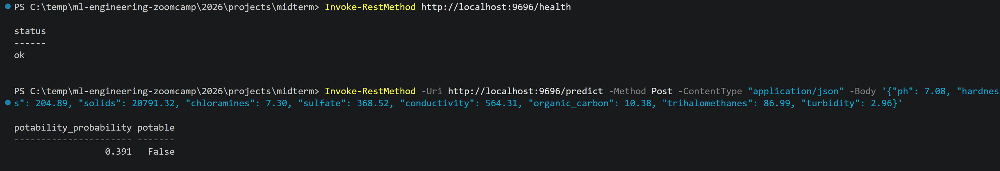
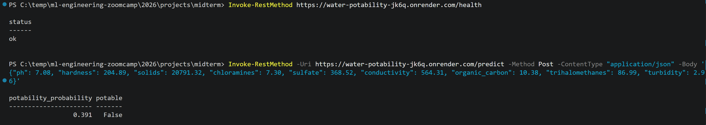

# Water Potability Prediction

Midterm project for the ML Engineering Zoomcamp.

## Problem

Lab testing of drinking water is slow and expensive. This project predicts whether a water sample is **potable** (`potability` = 1) or not (0) from nine physicochemical measurements. Water utilities and NGOs can use it as a fast screening step to decide which samples need priority lab analysis. It is not a replacement for certified testing.

**Metric:** ROC AUC, since the target is moderately imbalanced (~61% not potable, ~39% potable).

## Dataset

[Water Quality – Kaggle](https://www.kaggle.com/datasets/adityakadiwal/water-potability) by Aditya Kadiwal (CC0-1.0). 3,276 rows, 9 numeric features (`ph`, `hardness`, `solids`, `chloramines`, `sulfate`, `conductivity`, `organic_carbon`, `trihalomethanes`, `turbidity`) and the target `potability`.

The data is included in `data/water_potability.csv`. To download it yourself (requires a Kaggle API token):

```bash
kaggle datasets download -d adityakadiwal/water-potability -p data/ --unzip
```

## EDA

The data is split into train (60%), validation (20%) and test (20%), stratified on the target. EDA is done on the train + validation data only.

- Missing values in `ph` (~15%), `sulfate` (~24%) and `trihalomethanes` (~5%) appear random and are imputed with the median of the training set.
- The features are roughly normally distributed; outliers occur in both classes and look plausible, so they are kept.
- No single feature is predictive on its own (correlations with the target ≈ 0, single-feature ROC AUC 0.50–0.52).
- Potable water has a narrower pH range around 7, so `ph_dist = abs(ph - 7)` was added (ROC AUC 0.563).

## Modeling

Four models were tuned with 5-fold cross-validation on the train + validation data:

| Model | Best settings | CV ROC AUC |
|---|---|---|
| Random forest | max_depth=15, min_samples_leaf=1 | 0.652 ± 0.023 |
| XGBoost | eta=0.05, max_depth=6, min_child_weight=10 | 0.648 ± 0.015 |
| Decision tree | max_depth=8, min_samples_leaf=50 | 0.607 ± 0.046 |
| Logistic regression (baseline) | C=1 | 0.550 ± 0.025 |

Each more flexible model improves on the previous one. Without `ph_dist`, logistic regression drops to 0.497, so the engineered feature carries all of its predictive power.

**Final model:** random forest, trained on train + validation. **Test ROC AUC: 0.702.**

## Project structure

```
data/water_potability.csv   dataset
water_potability.ipynb      data preparation, EDA, model selection & tuning
train.py                    trains the final model → model.bin
predict.py                  loads the model and runs inference
serve.py                    Flask service: POST /predict, GET /health
model.bin                   trained model
requirements.txt            dependencies (Python 3.13)
Dockerfile                  container for the service
images/                     screenshots of the service in action
```

## How to run

### Locally

Create and activate a virtual environment (Python 3.13), then install the dependencies:

```bash
python -m venv .venv

# Windows (PowerShell)
.venv\Scripts\Activate.ps1

# macOS / Linux
source .venv/bin/activate

pip install -r requirements.txt
```

Train the model and start the service:

```bash
python train.py        # creates model.bin
python serve.py        # runs on http://localhost:9696
```

### With Docker

```bash
docker build -t water-potability .
docker run -it --rm -p 9696:9696 water-potability
```

## API usage

Health check:

```bash
curl http://localhost:9696/health
```

Prediction (bash / Git Bash):

```bash
curl -X POST http://localhost:9696/predict \
  -H "Content-Type: application/json" \
  -d '{"ph": 7.08, "hardness": 204.89, "solids": 20791.32, "chloramines": 7.30, "sulfate": 368.52, "conductivity": 564.31, "organic_carbon": 10.38, "trihalomethanes": 86.99, "turbidity": 2.96}'
```

Prediction (Windows PowerShell):

```powershell
Invoke-RestMethod -Uri http://localhost:9696/predict -Method Post -ContentType "application/json" -Body '{"ph": 7.08, "hardness": 204.89, "solids": 20791.32, "chloramines": 7.30, "sulfate": 368.52, "conductivity": 564.31, "organic_carbon": 10.38, "trihalomethanes": 86.99, "turbidity": 2.96}'
```

Response:

```json
{"potability_probability": 0.391, "potable": false}
```



Missing measurements may be left out of the request; they are filled in with the training median.

## Cloud deployment

The service is deployed on [Render](https://render.com) (free tier), built directly from this repository with the Dockerfile:

- Root directory: `2026/projects/midterm`
- Runtime: Docker
- Instance type: Free
- Environment variable: `PORT=9696`

URL: https://water-potability-jk6q.onrender.com

Health check:

```bash
curl https://water-potability-jk6q.onrender.com/health
```

Prediction (Windows PowerShell):

```powershell
Invoke-RestMethod -Uri https://water-potability-jk6q.onrender.com/predict -Method Post -ContentType "application/json" -Body '{"ph": 7.08, "hardness": 204.89, "solids": 20791.32, "chloramines": 7.30, "sulfate": 368.52, "conductivity": 564.31, "organic_carbon": 10.38, "trihalomethanes": 86.99, "turbidity": 2.96}'
```

The free tier sleeps after 15 minutes of inactivity, so the first request can take a while.



To stop the service and avoid any costs, delete it in the Render dashboard (Settings → Delete Web Service).

## Limitations and next steps

- The features correlate only weakly with the target, so model performance is moderate.
- The dataset has no information on sample location or time.
- The model is a screening tool only; decisions on water safety require certified lab testing.
- Next steps: tune the decision threshold to favour safety (fewer unsafe samples labelled as potable).